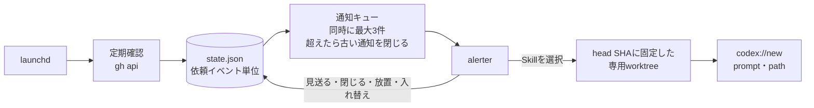

# review-notifier

自分宛てのGitHubレビュー依頼をmacOSに通知し、選んだSkillのプロンプトを入力済みのCodexスレッドを開く。
レビューするかの判断と送信は自分で行う。



## 動作

**通知**

依頼者・PRタイトル・リポジトリとPR番号を表示し、メニューからSkillを選ぶ。
依頼者が分からない場合は「依頼者不明」と表示する。
別の端末でGitHubの通知を既読にしても届く。

**重複**

同じ依頼は一度だけ通知する。
同じPRへの再依頼は新しい依頼として通知し、コメントやコミットの追加では通知しない。
初めて起動したときは、その時点の依頼を通知せずに記録だけする。

**見送りと放置**

見送る・閉じる・放置（既定は30分で閉じる）では何も起動せず、同じ依頼を再表示しない。
応答待ちの通知が上限（既定は3件）に達した状態で新しい依頼が届くと、最も古い通知を閉じて新しい依頼を表示する。
閉じた依頼は放置と同じ扱いになる。

**レビューの開始**

Skillを選ぶと、その時点のPRのheadに固定した専用worktreeを作り、Codex Appに新しいスレッドを開く。
プロンプトは入力済みで、Enterを押すとレビューが始まる。
普段のcheckoutのbranch・HEAD・作業中の変更は変わらない。
worktreeは自動で削除しない。
同じheadのworktreeに変更が残っていれば、別のworktreeを作る。

**開始できないとき**

checkoutが設定にない、originが違う、PRを取得できないなどの場合は、理由を通知して何も開かない。
cloneや別のディレクトリでの起動はしない。

**しないこと**

GitHubの通知の既読化、レビュー投稿、Approve、マージは行わない。
モデル・推論の強さ・スレッド名は指定できず、Codex Appの既定値になる。

## 導入

alerterはnix-darwinのHomebrew（`vjeantet/tap/alerter`）で入る。

```bash
mkdir -p ~/.config/review-notifier
cp ~/ghq/github.com/riii111/dotfiles/tools/review-notifier/config.example.json ~/.config/review-notifier/config.json
# config.jsonを編集してから
~/bin/dotctl review-notifier install
```

`install`は設定・コマンド・GitHub APIを確認し、問題がなければ常駐を始める。
更新時も同じコマンドを実行する。
初回の通知時に、macOSでalerterの通知を許可する。

```bash
~/bin/dotctl review-notifier status     # 常駐の状態と最近の依頼
~/bin/dotctl review-notifier logs -f    # ログ
~/bin/dotctl review-notifier stop
~/bin/dotctl review-notifier start      # 開始、または再起動
~/bin/dotctl review-notifier uninstall  # 設定・状態・ログ・worktreeは残す
```

## 設定

設定を変えたら`dotctl review-notifier start`で再起動する。
知らない項目があるとエラーになる。

```text
~/.config/review-notifier/config.json      端末ごとの設定（Git管理しない）
├── repositories                           owner/repo → ローカルcheckoutの絶対パス（~/ 可）
├── teams                                  通知するチーム宛て依頼（org/team-slug）。空なら自分宛てだけ
├── pollIntervalSeconds                    確認間隔。既定60、最小30
├── notificationTimeoutSeconds             通知を閉じるまでの秒数。既定1800
├── maxNotifications                       応答待ちで同時に出す通知の数。既定3、最大10
├── worktreeRoot                           worktreeの置き場所。既定 ~/.local/share/review-notifier/worktrees
├── commands                               gh・git・alerter・open・osascriptの絶対パス。省略時は自動で探す
└── choices[]                              通知メニューに並ぶ順の選択肢。追加・削除・並べ替えはここだけで反映
    ├── id                                 英小文字・数字・-
    ├── label                              メニューの表示名（カンマ不可）
    ├── skill                              Skill名。~/.codex/skills/<skill>/SKILL.md が必要
    └── prompt                             渡すプロンプト（Goのtext/template）
        ├── {{.PR.URL}} {{.PR.Title}}      PRのURL・タイトル
        ├── {{.PR.Repo}} {{.PR.Number}}    owner/repo・PR番号
        ├── {{.PR.HeadSHA}}                固定したheadのSHA
        ├── {{.PR.BaseRef}}                baseのブランチ名
        ├── {{.Requester}}                 依頼者（不明なら空）
        ├── {{.Skill}} {{.SkillPath}}      Skill名・SKILL.mdの絶対パス
        └── {{.Worktree}}                  専用worktreeの絶対パス
```

```text
~/.local/state/review-notifier/state.json  通知済み・見送りなどの記録。消すと初回起動と同じ扱い
~/Library/Logs/review-notifier.log         ログ
~/.local/share/review-notifier/worktrees/  <owner>/<repo>/pr-<番号>-<SHA先頭12桁>（2つ目以降は -2 など）
```

## 試す

常駐させずに、指定したPRで通知からスレッドを開くまでを試せる。
記録は残らない。

```bash
review-notifier check                                                         # 設定・コマンド・GitHub APIの確認
review-notifier smoke --pr owner/repo#123 --requester someone
review-notifier smoke --pr https://github.com/owner/repo/pull/123 --no-open  # 開く代わりにリンクを表示する
```

不要になったworktreeは`git -C <checkout> worktree remove <path>`で消す。
