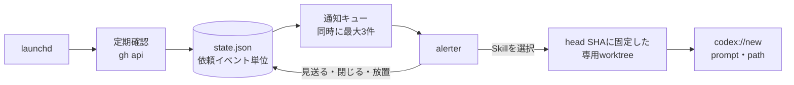

# review-notifier

自分宛てのGitHubレビュー依頼をmacOSに通知し、選んだSkillのプロンプトを入力済みのCodexスレッドを開く。
レビューするかの判断と送信はユーザーが行う。



## 動作

- 検知：`user-review-requested:@me`（設定した`teams`があれば`team-review-requested:<org/team>`も）でレビュー待ちのPRを検索し、各PRのイベントから`review_requested`を読む。
  検索結果を使うため、別の端末で通知を既読にしても検知できる。
  イベントの読み直しは、前回からPRが更新されたときだけ行う。
- 依頼者：`review_requested`イベントの`review_requester`を表示する。
  取得できない場合は「依頼者不明」と表示し、PR作成者で代用しない。
- 重複：依頼イベント単位で記録する。
  同じPRへの再依頼は新しい依頼として通知し、コメントやコミットの追加では再通知しない。
  初回は既存の依頼を基準として記録するだけで、通知しない。
- 通知：確認処理とは別に、キューから表示する。
  応答待ちの通知は`maxNotifications`件まで同時に出すため、放置した通知があっても後の依頼を表示できる。
  見送る・閉じる・本文クリック・タイムアウトでは何も起動せず、同じ依頼を再表示しない。
  通知中に停止した依頼は、再起動後にもう一度表示する。
- 起動：Skillを選んだ時点のPRを読み直し、そのhead SHAに固定したdetached worktreeを作る。
  元のcheckoutにはobjectを取得するだけで、branch・HEAD・作業ツリーは変更しない。
  同じheadのworktreeは、変更が残っていなければ再利用し、残っていれば番号付きの別のworktreeを作る。
  worktreeは自動で削除せず、残った変更も破棄しない。
  `codex://new?prompt=…&path=<worktree>`を開き、プロンプトは入力済み・未送信になる。
  スレッドでEnterを押すとレビューが始まる。
  起動中の記録が残ったまま停止した依頼は、二重に開かないよう失敗として扱う。
- 失敗：リポジトリのcheckoutが未設定・originが違う・取得できないなどの場合は、cloneや別ディレクトリでの起動をせず、理由を通知する。
  検索結果が欠けている場合も失敗として扱い、取り下げと誤認しない。
  APIの失敗やレート制限では、間隔を倍にしながら（最大15分）確認を続ける。
- 書き込み：GitHubの通知の既読化、レビュー投稿、Approve、マージは行わない。

Deep Linkにはモデル・推論の強さ・スレッド名の引数がないため、これらはAppの既定値になる。
worktreeの`.codex/config.toml`によるモデル指定と、プロンプトでのスレッド名変更はMac実機で効かなかったため採用していない。

## 導入

alerterはnix-darwinのHomebrew（`vjeantet/tap/alerter`）で入る。
`go`はNixのCLI profileに含まれる。

```bash
mkdir -p ~/.config/review-notifier
cp ~/ghq/github.com/riii111/dotfiles/tools/review-notifier/config.example.json ~/.config/review-notifier/config.json
# config.jsonを編集してから
~/bin/dotctl review-notifier install
```

`install`はビルドして`~/.local/bin/review-notifier`に置き、`review-notifier check`が通った場合だけLaunchAgentを読み込む。
更新時も同じコマンドを実行する。
初回の通知時に、macOSでalerterの通知を許可する。

```bash
~/bin/dotctl review-notifier status     # 読み込み状態と最近の依頼
~/bin/dotctl review-notifier logs -f    # ~/Library/Logs/review-notifier.log
~/bin/dotctl review-notifier stop
~/bin/dotctl review-notifier start      # 読み込み、または再起動
~/bin/dotctl review-notifier uninstall  # 設定・状態・ログ・worktreeは残す
```

## 設定

`~/.config/review-notifier/config.json`は端末ごとの設定で、Git管理しない。
設定を変えたら`dotctl review-notifier start`で再起動する。
未知の項目はエラーにする。

- `repositories`：`owner/repo`からローカルcheckoutの絶対パス（`~/`可）。
- `teams`：通知するチーム宛て依頼の`org/team-slug`。
  空なら本人への直接依頼だけを通知する。
- `pollIntervalSeconds`：確認間隔。
  省略時は60、最小30。
- `notificationTimeoutSeconds`：通知を閉じるまでの秒数。
  省略時は1800。
- `maxNotifications`：応答待ちで同時に出す通知の数。
  省略時は3、最大10。
  超えた依頼は先の通知が閉じるまで待つ。
- `worktreeRoot`：省略時は`~/.local/share/review-notifier/worktrees`。
  `<owner>/<repo>/pr-<番号>-<SHA先頭12桁>`（2つ目以降は`-2`などを付ける）に作る。
- `commands`：`gh`・`git`・`alerter`・`open`・`osascript`の絶対パス。
  省略時はNix profile・`/opt/homebrew/bin`・`/usr/bin`などの固定ディレクトリから探し、`PATH`は使わない。
- `choices`：通知のメニューに並ぶ順の選択肢。
  追加・削除・並べ替えは設定だけで反映される。
  - `id`：英小文字・数字・`-`。
  - `label`：メニューの表示名。
    カンマは使えない。
  - `skill`：`$CODEX_HOME/skills/<skill>/SKILL.md`が必要。
  - `prompt`：Goのtext/template。
    `.PR.URL`・`.PR.Repo`・`.PR.Number`・`.PR.Title`・`.PR.HeadSHA`・`.PR.BaseRef`・`.Requester`・`.Skill`・`.SkillPath`・`.Worktree`を使える。

状態は`~/.local/state/review-notifier/state.json`に保存する。
消すと次の起動で基準状態から記録し直す。

## 動作確認

```bash
review-notifier check                                  # 設定・コマンド・GitHub APIの確認
review-notifier smoke --pr owner/repo#123 --requester someone
review-notifier smoke --pr https://github.com/owner/repo/pull/123 --no-open  # Deep Linkを表示だけする
```

`smoke`は指定したPR1件で通知から起動までを行い、状態は記録しない。
worktreeの削除は`git -C <checkout> worktree remove <path>`で行う。

## Mac実機での確認状況

確認済み（smoke、alerter 26.5）：通知の表示、メニューからの選択、head SHAに固定したworktreeの作成と元のcheckoutが変わらないこと、作業場所がworktreeでプロンプト入力済みのスレッドが開き、Enterで選んだSkillのレビューが始まること。

未確認：見送り・タイムアウト時の動作、worktreeの再利用、`run`による常駐（launchd・検知・状態の引き継ぎ）、チーム宛て依頼。
